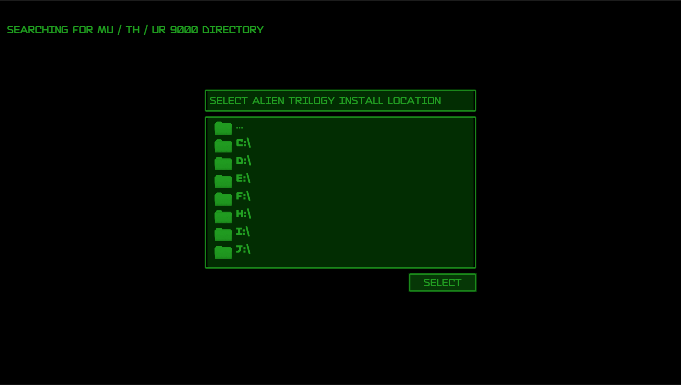
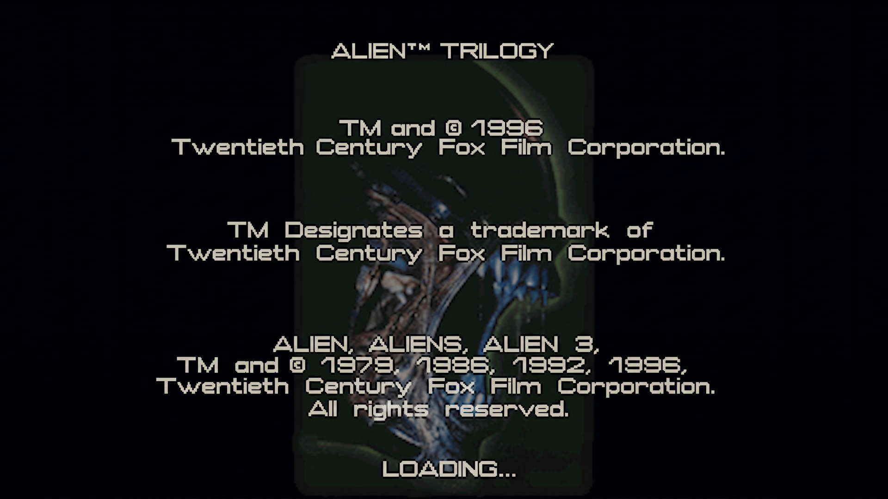
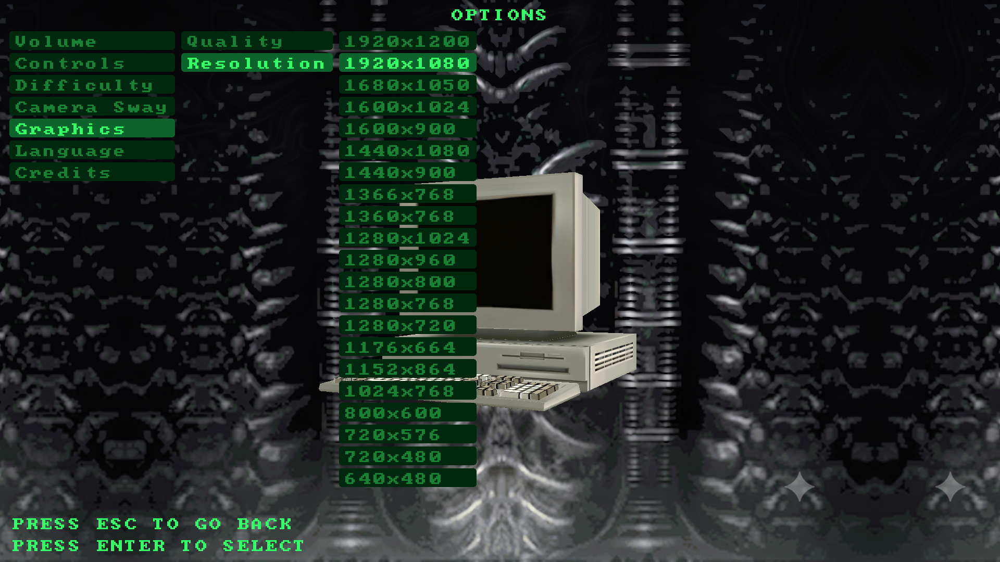
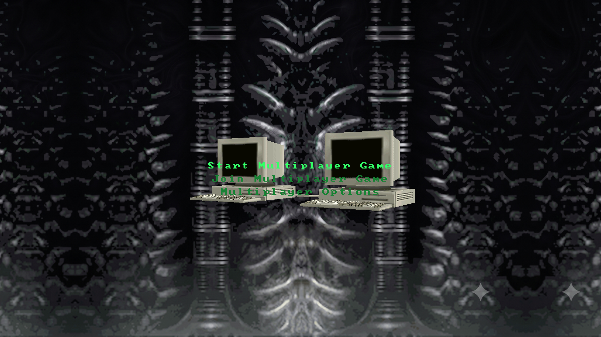
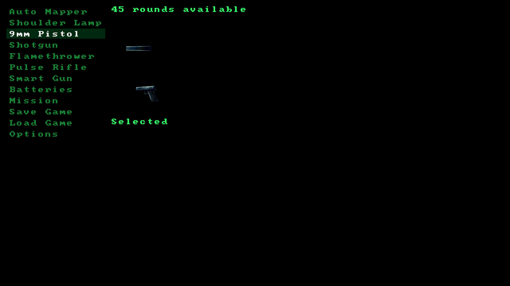
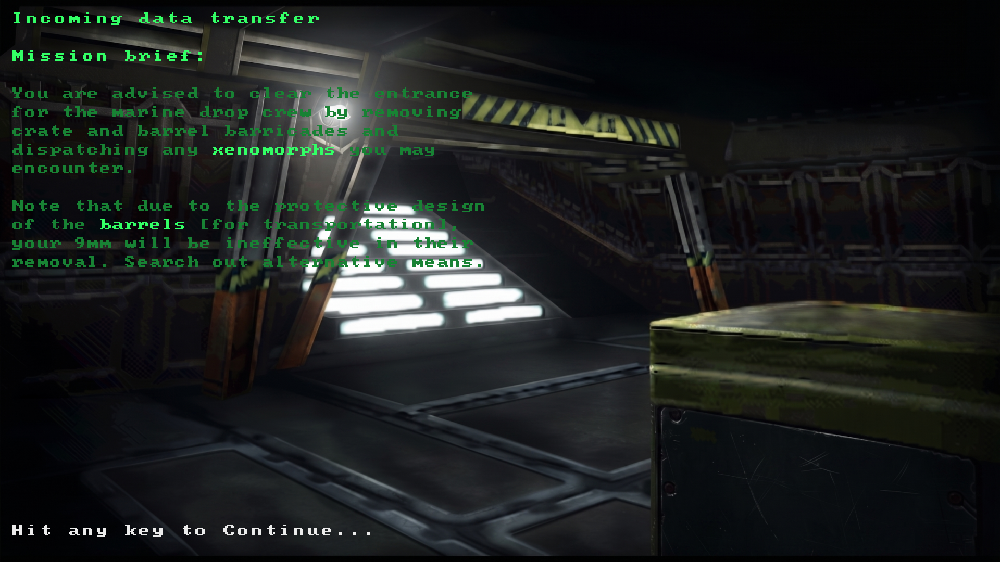
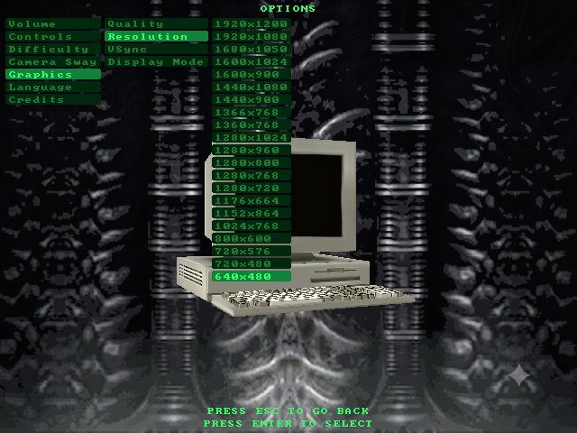
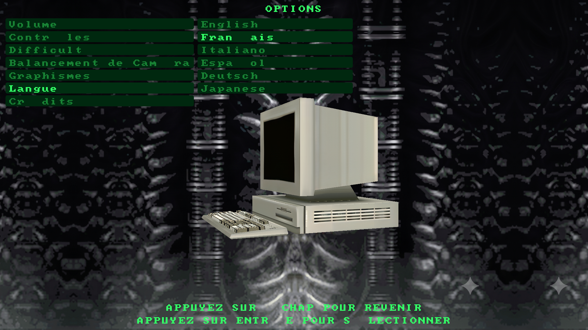
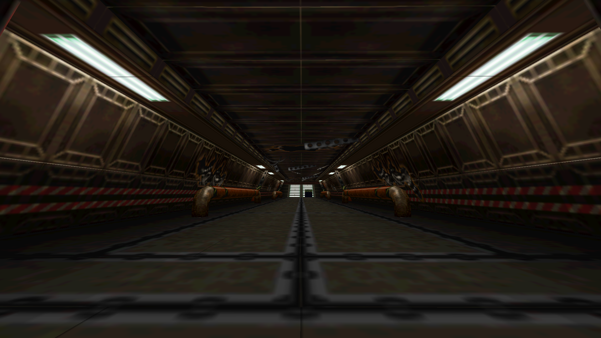
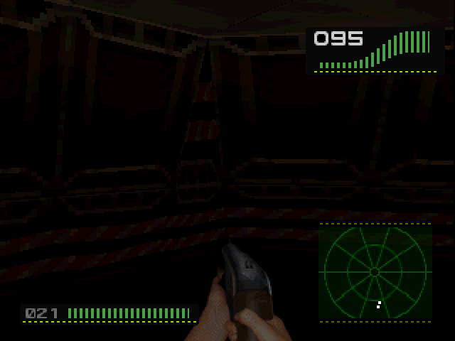

# Alien Trilogy Resurrection

This project aims to create a modding toolkit and possibly more for Alien Trilogy.

- 1 : Install the game from : https://collectionchamber.blogspot.com/2017/05/alien-trilogy.html or from an original media source.
- 2 : Download and install the latest version of the toolkit from [the releases page](https://github.com/Thor110/AlienTrilogyResurrection/releases) then place it in the game directory. ( Alongside "Run.exe" or "TRILOGY.EXE" )
- 3 : Optional : Install any patches using the patch button in the tool, the details of all patches made to original game files are in the "Patch" folder of this repository.

# Notes

This optional step has been removed as it needs revising sometime in the future, so ignore it for now.

- # : Optional : Use the cleanup script and files provided in "Notes\repack-disc-comparison\CLEANUPSCRIPT" to delete 83.35MBs of unused files from the game. ( documentation and details on these files and more can be found in "Notes\repack-disc-comparison\readme.txt" )

# To Do List

- Engine Reimplementation
	- Gameplay Mechanics
	- Multiplayer
- Text Editor
	- UI text viewing .BIN files plaintext.
	- Editing and saving functionality.
- Model Viewer
	- M036 is an unused model and does not have a corresponding texture.
	- M039 is an unused model which is the same as the #41 the egg-husk.
	- M040 is the hibernation pod cover which does not have a texture, I believe this is likely coloured in code with a single colour.
- Graphics Viewer
	- Compressed images can not be replaced yet, until I implement a recompression algorithm that matches the original exactly.
- Level Viewer
	- Not really a level "viewer" per-se, currently it is just a testing tool for parsing level data, it can also export the level geometry as OBJ files.
	- May or may not extend it to level viewer and editor functionality one day.
	- Need to implement an export feature for the location of level objects, enemies, crates, pickups, switches, doors etc
- Patches
	- The texture scan has more candidates on L263LEV, L351LEV and L371LEV still to be reviewed.
	- The UVs for the Queens Egg Sack from the final level are now fixed (see L391LEV Fix 1).

# Road Map

The road map for this project.

- [❌ 0 : Engine Reimplementation](#engine-reimplementation) ( 25% Complete )
	- Original CD detection and selective asset extraction
	- Automated Redbook CD-DA audio ripping and pre-bundled playlist generation
	- Native image and video override architecture
	- Upgraded cutscene video playback pipeline (BSRGAN upscaled via local NCNN, batch-processed through FFmpeg)
	- Integrated main menu audio, functional layout drafts, options configs, resolution detection  and selection.
	- Graphics quality options smoothed and original rendering styles. (WIP)
	- Resolution scaling.
	- Modular language localization system.
- [❌ 1 : Text Editor](#text-editor) ( 50% Complete )
	- View text from the games missions and user interface.
	- Editing and saving functions not implemented yet.
	- Effectively a cancelled feature, the text is stored in .txt and .bin files as plain text. If you want to edit those, you don't need a toolkit for it.
- [✅ 2 : Model Viewer](#model-viewer) ( 99% Complete )
	- Can extract models from the three known model files.
	- Does not currently extract the associated textures alongside them.
- [✅ 3 : Graphics Viewer](#graphics-viewer) ( 99% Complete )
	- Palette detection implemented.
	- Toggle palette export or transparency for viewing and exporting.
	- View, export and replace textures, replacing compressed images is not supported yet. ( .B16 files, weapons and enemies. )
	- Automatic backup of the original file by default.
- [✅ 4 : Palette Editor](#palette-editor) ( 100% Complete )
	- Palette editor and image preview.
	- View, export, import and edit palettes for all types of images. ( Embedded, External & Compressed )
	- Visual feedback showing unused colours across all sections and frames, except for embedded palettes where each section has its own colour palette.
	- Automatic backup of the original file by default.
- [✅ 5 : Sound Effects Viewer](#sound-effects-viewer) ( 100% Complete )
	- .RAW audio files can be played, replaced and converted to and from .WAV files.
	- Waveform preview for selected sound files.
	- Link to the music directory, only available with the repack.
	- Automatic backup of the original file by default.
- [❌ 6 : Level Viewer](#level-viewer) ( 99% Complete )
	- Map files detected and listed.
	- Basic details parsed and listed.
	- Export level geometry as OBJ files.
	- Export levels with debug and unknown byte flags displayed visually.
	- Export door and lift geometry as OBJ files.
	- Does not currently extract the associated textures alongside them.
	- Provides a list based interface for looking through the parsed objects within each level.
	- Has a preview of the levels map generated using the collision blocks parsed for the level.
- [❌ 7 : Patches](#patches) ( ??% Complete )
	- [Patched an issue on L906LEV where a vertex had incorrect coordinates.](#L906LEV-Multiplayer-Map-7-Fix-1)
	- [Patched an issue on L906LEV where four faces were lacking the double sided transparency flag.](#L906LEV-Multiplayer-Map-7-Fix-2)
	- [Patched an issue on L906LEV where one railing was lacking the double sided transparency flag.](#L906LEV-Multiplayer-Map-7-Fix-3)
	- [Patched an issue on L906LEV where one railing was lacking the double sided transparency flag.](#L906LEV-Multiplayer-Map-7-Fix-4)
	- [Patched an issue on L906LEV where 8 different bridge sections had incorrect textures and UV coordinates.](#L906LEV-Multiplayer-Map-7-Fix-5)
	- [Patched an issue on L906LEV where doors had incorrectly flipped textures.](#L906LEV-Multiplayer-Map-7-Fix-6)
	- [Patched an issue on L905LEV where 2 textures were flipped when they shouldn't have been.](#L905LEV-Multiplayer-Map-6-Fix-1)
	- [Patched an issue on L905LEV where lots of different textures were flipped when they shouldn't have been.](#L905LEV-Multiplayer-Map-6-Fix-2)
	- [Patched an issue on L903LEV where some crates had incorrect textures.](#L903LEV-Multiplayer-Map-4-Fix-1)
	- [Patched an issue on L901LEV where player storage was located within the level boundaries.](#L901LEV-Multiplayer-Map-2-Fix-1)
	- [Patched an issue on L900LEV where four crates had textures which were sideways.](#L900LEV-Multiplayer-Map-1-Fix-1)
	- [Patched an issue on L900LEV where multiple texture flags were incorrectly set.](#L900LEV-Multiplayer-Map-1-Fix-2)
	- [Patched an issue on L900LEV where a vertex in the first lift had the wrong Z coordinate.](#L900LEV-Multiplayer-Map-1-Fix-3)
	- [Patched an issue on L900LEV where a face was assigned the wrong texture index.](#L900LEV-Multiplayer-Map-1-Fix-4)
	- [Patched an issue on L900LEV where the starting lift panel had its texture flipped.](#L900LEV-Multiplayer-Map-1-Fix-5)
	- [Patched an issue on L111LEV where four crates had textures which were sideways.](#L111LEV-Fix-1)
	- [Patched an issue on L111LEV where multiple texture flags were incorrectly set.](#L111LEV-Fix-2)
	- [Patched an issue on L111LEV where a vertex in the first lift had the wrong Z coordinate.](#L111LEV-Fix-3)
	- [Patched an issue on L111LEV where a face was assigned the wrong texture index.](#L111LEV-Fix-4)
	- [Patched an issue on L111LEV where the starting lift panel had its texture flipped.](#L111LEV-Fix-5)
	- [Patched an issue on L141LEV where some crates had incorrect textures.](#L141LEV-Fix-1)
	- [Patched an issue on L161LEV where one face had an incorrect texture.](#L161LEV-Fix-1)
	- [Patched an issue on L161LEV where one face on a door had an incorrect texture.](#L161LEV-Fix-2)
	- [Patched an issue on L162LEV where one face on the starting door had an incorrect texture.](#L162LEV-Fix-1)
	- [Patched an issue on L371LEV where a secret area was inaccessible.](#L371LEV-Fix-1)
	- [Patched an issue on L371LEV where two faces had incorrect textures.](#L371LEV-Fix-2)
	- [Patched an issue on L371LEV where one of the textures unused tiles showed up at the edges of some faces.](#L371LEV-Fix-3)
	- [Plus the texture scan fixes, the walk-through pillars on L903LEV and the duplicate door and lift model removal: see the full list.](#patches)
- [✅ 8 : Easter Eggs](#easter-eggs) ( ??% Complete )
	- [Grade 33 Steel](#easter-egg-1)
	- [End Times](#easter-egg-2)
	- [Cheats](#easter-egg-3)

And possibly more to come.

Discord : https://discord.gg/Mk2YUuPmdU

## Documentation

Special thanks to Bobblen147 who created this repository : https://github.com/Bobblen147/atril_geom_extract

They also pointed me to the partial file format documentation and the texture decompression source code from Lex Safanov, the links to which are also in their repository on the great preserver archive.org which will save me endless amounts of time manually decoding the filetypes.

Also a big thanks to Lex Safanov for posting their source code for decompression of .B16 files, I used this as reference when reimplementing it for this project.

A thanks to bambamalicious for discovering the fix for the inaccessible secret on L371LEV. It sets the lift's trigger threshold to 1, which turns out to be the value the level's own scripts were built for: the lift's only other trigger is a switch at the bottom, inside the secret, so with the original value the lift could never be taken down (see Patch/L371LEV.txt).

And thanks to Kaiser for information regarding animated textures and some other previously unknown bytes.

## Engine Reimplementation

Engine reimplementation is currently a work in progress.

MU/TH/UR Computer System Interface

This is used to locate the disc or game installation, copy the necessary files, rip the music tracks, patch game files and is only shown on the first launch of the game.

<div align="center">
  
</div>

Legal Screen - Upscaled

<div align="center">
  
</div>

Probe Logo Video - Upscaled

<div align="center">
  
</div>

Main Menu - Upscaled Background

<div align="center">
  
</div>

Options Menu - Upscaled Background

<div align="center">
  
</div>

Multiplayer Menu - Upscaled Background

<div align="center">
  
</div>

Pause Menu

<div align="center">
  
</div>

Briefing Menu - Upscaled Background

<div align="center">
  
</div>

Resolution Scaling

<div align="center">
  
</div>

Localization System - Modular Language Packs

<div align="center">
  
</div>

First Level

<div align="center">
  
</div>

### Building the engine

The engine builds on Windows, Linux and macOS; every push is built and tested on all three by `.github/workflows/build.yml`, which keeps each build as a downloadable artifact.

Windows (Visual Studio 2022 with vcpkg, `VCPKG_ROOT` set):

```
cd ALTEngine
cmake --preset windows-release
cmake --build out/build/windows-release
```

To gather a release from that build, run `tools\make_release.bat` from the `ALTEngine` folder (`/zip` also packs it). It copies only what the game needs into `out\build\ALTEngine-v<version>`: the executable and its DLLs, the licences, `data`, and the language, override and custom folders. The version number is in `ALTEngine\VERSION`.

Linux (Ubuntu 24.04 or similar; SDL3 is built from source the first time, as Ubuntu has no package for it):

```
sudo apt-get install ninja-build pkg-config nlohmann-json3-dev glslang-tools spirv-cross \
  libavcodec-dev libavformat-dev libavutil-dev libswscale-dev libswresample-dev \
  libx11-dev libxext-dev libxrandr-dev libxcursor-dev libxfixes-dev libxi-dev libxss-dev \
  libxtst-dev libxkbcommon-dev libwayland-dev wayland-protocols libegl1-mesa-dev \
  libgl1-mesa-dev libasound2-dev libpulse-dev libudev-dev libdbus-1-dev
cd ALTEngine
cmake -S . -B out/build/release -G Ninja -DCMAKE_BUILD_TYPE=Release
cmake --build out/build/release
```

macOS (Homebrew):

```
brew install ninja pkg-config sdl3 ffmpeg nlohmann-json glslang spirv-cross
cd ALTEngine
cmake -S . -B out/build/release -G Ninja -DCMAKE_BUILD_TYPE=Release
cmake --build out/build/release
```

The tests run with `ctest --test-dir <build folder>`. A mounted disc under `/Volumes`, `/media` or `/mnt` is found automatically, and the music is ripped from it on all three systems: on Linux straight from the drive, on macOS from the audio tracks macOS mounts itself (or the drive if those aren't there).

The build also makes `ALTLevelScan`, which checks every level for faces whose texture is turned or mirrored against the faces next to it. Run it from the `ALTEngine` folder as `ALTLevelScan <CD folder>` (the folder holding `SECT11`, `SECT12` and so on). It writes `LevelUvScan.json`, which lists the suspect faces, strongest first, with a `faceUvRotations` entry for each in Patches.json's form. Check each one in the viewer before copying it across. `--level 391` scans one level; run with no arguments, it prints its options.

## Alien Trilogy Viewer

The main program window.

<div align="center">
  
</div>

## Text Editor

Edit text in the game, intended for localisation efforts.

<div align="center">
  
</div>

## Model Viewer

Extract models from the games files.

<div align="center">
  
</div>

A showcase of some of the models from the games files.

<div align="center">
  
</div>

## Graphics Viewer

View, extract and replace textures from the game.

<div align="center">
  
</div>

View, extract and replace animation frames in the game. ( Note : Replacing animation frames is not supported yet )

<div align="center">
  
</div>

Replace textures. ( Example : Barrel texture used for the Crate )

<div align="center">
  
</div>

## Palette Editor

Preview, edit, save, import and export palettes while previewing the image it belongs to.

<div align="center">
  
</div>

This image shows a compressed file palette that has been replaced.

<div align="center">
  
</div>

This image shows an embedded palette that has been replaced.

<div align="center">
  
</div>

## Sound Effects Viewer

Listen to, extract, replace or restore audio files from backups.

<div align="center">
  
</div>

## Level Viewer

View level data and export level models as OBJ files.

<div align="center">
  
</div>

Preview of L111LEV exported as an OBJ file.

<div align="center">
  
</div>

A view of L112LEV from within Blender.

<div align="center">
  
</div>

A preview of the door D000 from L111LEV.

<div align="center">
  
</div>

A preview of the lift L000 from L232LEV.

<div align="center">
  
</div>

## Patches

I am also looking at making patches for any issues I find in the original game.

Fixes marked "texture scan" were found by ALTLevelScan, which looks for faces whose texture does not run on from the faces around them. Each one was rendered before and after and kept only after review; the scan number (for example 321-1) identifies each one for screenshots. The exact bytes for every fix are listed in the Patch folder, and both ALTEngine and ALTViewer apply them.

- [Patched an issue on L909LEV where one face had its texture rotated (texture scan 909-14).](#L909LEV-Multiplayer-Map-10-Fix-1)
- [Patched an issue on L909LEV where one face had its texture rotated (texture scan 909-15).](#L909LEV-Multiplayer-Map-10-Fix-2)
- [Patched an issue on L909LEV where one face had its texture flipped (texture scan 909-19).](#L909LEV-Multiplayer-Map-10-Fix-3)
- [Patched an issue on L909LEV where one face had its texture rotated (texture scan 909-20).](#L909LEV-Multiplayer-Map-10-Fix-4)
- [Patched an issue on L909LEV where one face had its texture flipped and rotated (texture scan 909-23).](#L909LEV-Multiplayer-Map-10-Fix-5)
- [Patched an issue on L908LEV where one face had its texture rotated (texture scan 908-1).](#L908LEV-Multiplayer-Map-9-Fix-1)
- [Patched an issue on L908LEV where one face had its texture rotated (texture scan 908-12).](#L908LEV-Multiplayer-Map-9-Fix-2)
- [Patched an issue on L906LEV where a vertex had incorrect coordinates.](#L906LEV-Multiplayer-Map-7-Fix-1)
- [Patched an issue on L906LEV where four faces were lacking the double sided transparency flag.](#L906LEV-Multiplayer-Map-7-Fix-2)
- [Patched an issue on L906LEV where one railing was lacking the double sided transparency flag.](#L906LEV-Multiplayer-Map-7-Fix-3)
- [Patched an issue on L906LEV where one railing was lacking the double sided transparency flag.](#L906LEV-Multiplayer-Map-7-Fix-4)
- [Patched an issue on L906LEV where 8 different bridge sections had incorrect textures and UV coordinates.](#L906LEV-Multiplayer-Map-7-Fix-5)
- [Patched an issue on L906LEV where doors had incorrectly flipped textures.](#L906LEV-Multiplayer-Map-7-Fix-6)
- [Patched an issue on L905LEV where 2 textures were flipped when they shouldn't have been.](#L905LEV-Multiplayer-Map-6-Fix-1)
- [Patched an issue on L905LEV where lots of different textures were flipped when they shouldn't have been.](#L905LEV-Multiplayer-Map-6-Fix-2)
- [Patched an issue on L905LEV where two faces had their textures flipped (texture scan 905-1).](#L905LEV-Multiplayer-Map-6-Fix-3)
- [Patched an issue on L903LEV where some crates had incorrect textures.](#L903LEV-Multiplayer-Map-4-Fix-1)
- [Patched an issue on L903LEV where two pillars could be walked through.](#L903LEV-Multiplayer-Map-4-Fix-2)
- [Patched an issue on L901LEV where player storage was located within the level boundaries.](#L901LEV-Multiplayer-Map-2-Fix-1)
- [Patched an issue on L900LEV where four crates had textures which were sideways.](#L900LEV-Multiplayer-Map-1-Fix-1)
- [Patched an issue on L900LEV where multiple texture flags were incorrectly set.](#L900LEV-Multiplayer-Map-1-Fix-2)
- [Patched an issue on L900LEV where a vertex on a lift had a misplaced coordinate.](#L900LEV-Multiplayer-Map-1-Fix-3)
- [Patched an issue on L900LEV where a face was assigned the wrong texture index.](#L900LEV-Multiplayer-Map-1-Fix-4)
- [Patched an issue on L900LEV where the starting lift panel had its texture flipped.](#L900LEV-Multiplayer-Map-1-Fix-5)
- [Patched an issue on L111LEV where four crates had textures which were sideways.](#L111LEV-Fix-1)
- [Patched an issue on L111LEV where multiple texture flags were incorrectly set.](#L111LEV-Fix-2)
- [Patched an issue on L111LEV where a vertex on a lift had a misplaced coordinate.](#L111LEV-Fix-3)
- [Patched an issue on L111LEV where a face was assigned the wrong texture index.](#L111LEV-Fix-4)
- [Patched an issue on L111LEV where the starting lift panel had its texture flipped.](#L111LEV-Fix-5)
- [Patched an issue on L141LEV where some crates had incorrect textures.](#L141LEV-Fix-1)
- [Patched an issue on L154LEV where one face had its texture flipped and rotated (texture scan 154-1).](#L154LEV-Fix-1)
- [Patched an issue on L161LEV where one face had an incorrect texture.](#L161LEV-Fix-1)
- [Patched an issue on L161LEV where one face on a door had an incorrect texture.](#L161LEV-Fix-2)
- [Patched an issue on L161LEV where one face had its texture rotated (texture scan 161-1).](#L161LEV-Fix-3)
- [Patched an issue on L161LEV where one face had its texture flipped and rotated (texture scan 161-2).](#L161LEV-Fix-4)
- [Patched an issue on L162LEV where one face on the starting door had an incorrect texture.](#L162LEV-Fix-1)
- [Patched an issue on L211LEV where three faces had their textures flipped and rotated (texture scan 211-1).](#L211LEV-Fix-1)
- [Patched an issue on L263LEV where one face had its texture flipped and rotated (texture scan 263-3).](#L263LEV-Fix-1)
- [Patched an issue on L311LEV where one face had its texture rotated (texture scan 311-1).](#L311LEV-Fix-1)
- [Patched an issue on L311LEV where one face had its texture rotated (texture scan 311-9).](#L311LEV-Fix-2)
- [Patched an issue on L311LEV where one face had its texture rotated (texture scan 311-12).](#L311LEV-Fix-3)
- [Patched an issue on L321LEV where three faces had their textures rotated (texture scan 321-1).](#L321LEV-Fix-1)
- [Patched an issue on L321LEV where three faces had their textures flipped and rotated (texture scan 321-2).](#L321LEV-Fix-2)
- [Patched an issue on L321LEV where three faces had their textures rotated (texture scan 321-3).](#L321LEV-Fix-3)
- [Patched an issue on L321LEV where three faces had their textures flipped and rotated (texture scan 321-4).](#L321LEV-Fix-4)
- [Patched an issue on L321LEV where one face had its texture rotated (texture scan 321-10).](#L321LEV-Fix-5)
- [Patched an issue on L321LEV where one face had its texture rotated (texture scan 321-11).](#L321LEV-Fix-6)
- [Patched an issue on L321LEV where one face had its texture rotated (texture scan 321-12).](#L321LEV-Fix-7)
- [Patched an issue on L321LEV where one face had its texture rotated (texture scan 321-13).](#L321LEV-Fix-8)
- [Patched an issue on L321LEV where one face had its texture flipped (texture scan 321-14).](#L321LEV-Fix-9)
- [Patched an issue on L321LEV where one face had its texture flipped (texture scan 321-15).](#L321LEV-Fix-10)
- [Patched an issue on L321LEV where one face had its texture flipped (texture scan 321-16).](#L321LEV-Fix-11)
- [Patched an issue on L322LEV where one face had its texture flipped (texture scan 322-2).](#L322LEV-Fix-1)
- [Patched an issue on L322LEV where one face had its texture flipped (texture scan 322-4).](#L322LEV-Fix-2)
- [Patched an issue on L322LEV where one face had its texture flipped (texture scan 322-5).](#L322LEV-Fix-3)
- [Patched an issue on L322LEV where one face had its texture flipped (texture scan 322-8).](#L322LEV-Fix-4)
- [Patched an issue on L323LEV where one face had its texture rotated (texture scan 323-2).](#L323LEV-Fix-1)
- [Patched an issue on L323LEV where one face had its texture rotated (texture scan 323-3).](#L323LEV-Fix-2)
- [Patched an issue on L323LEV where one face had its texture flipped (texture scan 323-4).](#L323LEV-Fix-3)
- [Patched an issue on L323LEV where one face had its texture flipped (texture scan 323-6).](#L323LEV-Fix-4)
- [Patched an issue on L323LEV where one face had its texture flipped (texture scan 323-9).](#L323LEV-Fix-5)
- [Patched an issue on L324LEV where one face had its texture rotated (texture scan 324-2).](#L324LEV-Fix-1)
- [Patched an issue on L324LEV where one face had its texture flipped (texture scan 324-3).](#L324LEV-Fix-2)
- [Patched an issue on L324LEV where one face had its texture flipped (texture scan 324-5).](#L324LEV-Fix-3)
- [Patched an issue on L324LEV where one face had its texture flipped (texture scan 324-8).](#L324LEV-Fix-4)
- [Patched an issue on L324LEV where one face had its texture flipped (texture scan 324-9).](#L324LEV-Fix-5)
- [Patched an issue on L325LEV where one face had its texture rotated (texture scan 325-2).](#L325LEV-Fix-1)
- [Patched an issue on L325LEV where one face had its texture flipped (texture scan 325-3).](#L325LEV-Fix-2)
- [Patched an issue on L325LEV where one face had its texture rotated (texture scan 325-6).](#L325LEV-Fix-3)
- [Patched an issue on L325LEV where one face had its texture rotated (texture scan 325-8).](#L325LEV-Fix-4)
- [Patched an issue on L331LEV where one face had its texture rotated (texture scan 331-2).](#L331LEV-Fix-1)
- [Patched an issue on L331LEV where one face had its texture rotated (texture scan 331-3).](#L331LEV-Fix-2)
- [Patched an issue on L331LEV where one face had its texture rotated (texture scan 331-4).](#L331LEV-Fix-3)
- [Patched an issue on L331LEV where one face had its texture flipped (texture scan 331-6).](#L331LEV-Fix-4)
- [Patched an issue on L331LEV where one face had its texture flipped (texture scan 331-7).](#L331LEV-Fix-5)
- [Patched an issue on L351LEV where the top row of the resin wall had two faces rotated and two flipped.](#L351LEV-Fix-1)
- [Patched an issue on L351LEV where two faces had their textures flipped and rotated (texture scan 351-3).](#L351LEV-Fix-2)
- [Patched an issue on L351LEV where one face had its texture rotated (texture scan 351-4).](#L351LEV-Fix-3)
- [Patched an issue on L351LEV where one face had its texture flipped and rotated (texture scan 351-5).](#L351LEV-Fix-4)
- [Patched an issue on L351LEV where one face had its texture flipped and rotated (texture scan 351-7).](#L351LEV-Fix-5)
- [Patched an issue on L351LEV where one face had its texture rotated (texture scan 351-9).](#L351LEV-Fix-6)
- [Patched an issue on L351LEV where one face had its texture flipped (texture scan 351-10).](#L351LEV-Fix-7)
- [Patched an issue on L351LEV where one face had its texture rotated (texture scan 351-11).](#L351LEV-Fix-8)
- [Patched an issue on L351LEV where one face had its texture rotated (texture scan 351-12).](#L351LEV-Fix-9)
- [Patched an issue on L351LEV where one face had its texture flipped and rotated (texture scan 351-13).](#L351LEV-Fix-10)
- [Patched an issue on L352LEV where one face had its texture rotated (texture scan 352-1).](#L352LEV-Fix-1)
- [Patched an issue on L352LEV where one face had its texture rotated (texture scan 352-2).](#L352LEV-Fix-2)
- [Patched an issue on L353LEV where two faces had their textures flipped (texture scan 353-1).](#L353LEV-Fix-1)
- [Patched an issue on L353LEV where one face had its texture rotated (texture scan 353-2).](#L353LEV-Fix-2)
- [Patched an issue on L353LEV where one face had its texture rotated (texture scan 353-3).](#L353LEV-Fix-3)
- [Patched an issue on L371LEV where a secret area was inaccessible.](#L371LEV-Fix-1)
- [Patched an issue on L371LEV where two faces had incorrect textures.](#L371LEV-Fix-2)
- [Patched an issue on L371LEV where one of the textures unused tiles showed up at the edges of some faces.](#L371LEV-Fix-3)
- [Patched an issue on L371LEV where eight faces had their textures flipped and rotated (texture scan 371-1).](#L371LEV-Fix-4)
- [Patched an issue on L371LEV where one face had its texture rotated (texture scan 371-3).](#L371LEV-Fix-5)
- [Patched an issue on L371LEV where one face had its texture rotated (texture scan 371-4).](#L371LEV-Fix-6)
- [Patched an issue on L371LEV where one face had its texture rotated (texture scan 371-5).](#L371LEV-Fix-7)
- [Patched an issue on L381LEV where one face had its texture rotated (texture scan 381-1).](#L381LEV-Fix-1)
- [Patched an issue on L391LEV where 246 faces of the queen's egg sack had their texture turned.](#L391LEV-Fix-1)
- [Patched an issue on L391LEV where one face had its texture rotated (texture scan 391-1).](#L391LEV-Fix-2)
- [Patched an issue on L391LEV where one face had its texture rotated (texture scan 391-2).](#L391LEV-Fix-3)
- [Patched an issue on L391LEV where one face had its texture rotated (texture scan 391-3).](#L391LEV-Fix-4)
- [Removed duplicate and unused door and lift models from 21 levels.](#Duplicate-Door-And-Lift-Models)

## L909LEV Multiplayer Map 10 Fix 1

UV rotation corrected.

Found by texture scan 909-14. Face 3917 is corrected so the texture runs on from the faces around it.

Patch listed at Patch/L909LEV.txt

## L909LEV Multiplayer Map 10 Fix 2

UV rotation corrected.

Found by texture scan 909-15. Face 6022 is corrected so the texture runs on from the faces around it.

Patch listed at Patch/L909LEV.txt

## L909LEV Multiplayer Map 10 Fix 3

UV flipped.

Found by texture scan 909-19. Face 1631 is corrected so the texture runs on from the faces around it.

Patch listed at Patch/L909LEV.txt

## L909LEV Multiplayer Map 10 Fix 4

UV rotation corrected.

Found by texture scan 909-20. Face 9710 is corrected so the texture runs on from the faces around it.

Patch listed at Patch/L909LEV.txt

## L909LEV Multiplayer Map 10 Fix 5

UV flipped and rotation corrected.

Found by texture scan 909-23. Face 4541 is corrected so the texture runs on from the faces around it.

Patch listed at Patch/L909LEV.txt

## L908LEV Multiplayer Map 9 Fix 1

UV rotation corrected.

Found by texture scan 908-1. Face 7758 is corrected so the texture runs on from the faces around it.

Patch listed at Patch/L908LEV.txt

## L908LEV Multiplayer Map 9 Fix 2

UV rotation corrected.

Found by texture scan 908-12. Face 11010 is corrected so the texture runs on from the faces around it.

Patch listed at Patch/L908LEV.txt

## L906LEV Multiplayer Map 7 Fix 1

Here is how the level was originally.

<div align="center">
  
</div>

This would cause this to appear when close enough to the missing triangle.

<div align="center">
  
</div>

Here it is with the fix I applied to the level.

<div align="center">
  
</div>

## L906LEV Multiplayer Map 7 Fix 2

Here is how the level was originally.

<div align="center">
  
</div>

Here it is with the fix I applied to the level.

<div align="center">
  
</div>

## L906LEV Multiplayer Map 7 Fix 3

Here is how the level was originally.

<div align="center">
  
</div>

Here it is with the fix I applied to the level.

<div align="center">
  
</div>

## L906LEV Multiplayer Map 7 Fix 4

Here is how the level was originally.

<div align="center">
  
</div>

Here it is with the fix I applied to the level.

<div align="center">
  
</div>

## L906LEV Multiplayer Map 7 Fix 5

Here is how the level was originally.

<div align="center">
  
</div>

Here it is with the fix I applied to the level.

<div align="center">
  
</div>

This used to be fixed only when exporting the model, on top of a partial fix in the game files. All 53 bridge faces are now fixed in the level file itself: UV rotation corrected on 24, UV flipped and rotation corrected on 29. Applied by both ALTEngine and ALTViewer's patch button. The face list, with the old export remap for each, is in Patch/L906LEV.txt.

## L906LEV Multiplayer Map 7 Fix 6

Here is how the level was originally.

<div align="center">
  
</div>

Here it is with the fix I applied to the level.

<div align="center">
  
</div>

## L905LEV Multiplayer Map 6 Fix 1

Here is how the level was originally.

<div align="center">
  
</div>

Here it is with the fix I applied to the level.

<div align="center">
  
</div>

## L905LEV Multiplayer Map 6 Fix 2

Here is how the level was originally.

<div align="center">
  
</div>

Here it is with the fix I applied to the level.

<div align="center">
  
</div>

## L905LEV Multiplayer Map 6 Fix 3

UV flipped.

Found by texture scan 905-1. Face 1673 and the face beside it at offset 0x23858 are corrected so the texture runs on from the faces around them.

Patch listed at Patch/L905LEV.txt

## L903LEV Multiplayer Map 4 Fix 1

[These fixes are the same as on L141LEV](#L141LEV-Fix-1)
	
This used to be fixed only when exporting the level model. It is now fixed in the level file, on the same faces at the same offsets as L141LEV. Applied by both ALTEngine and ALTViewer's patch button. Details in Patch/L903LEV.txt.

## L903LEV Multiplayer Map 4 Fix 2

L903LEV is built from L141LEV: the same grid and the same geometry. Four of its map cells lost their wall attribute along the way, so the two pillars at cells (11,43) and (11,48) could be walked into. The four cells are restored to L141LEV's values.

| Offset | Cell | Was | Now |
|---|---|---|---|
| 0x69002 | (12,42) | 00 | 14 |
| 0x69502 | (11,43) | 00 | 14 (pillar) |
| 0x6AE52 | (11,48) | 00 | 14 (pillar) |
| 0x6E862 | (49,59) | 00 | 15 |

Patch listed at Patch/L903LEV.txt

## L901LEV Multiplayer Map 2 Fix 1

This shows where four enemy types are spawned within the level, in other levels these are clustered together off of the map.

The four highlighted objects show where player movement was previously blocked.

I believe these enemy types are placeholders for the players. Image taken within an abandoned unity toolkit based off of my code.

<div align="center">
  
</div>

Here it is with the fix I applied to the level.

<div align="center">
  
</div>

## L900LEV Multiplayer Map 1 Fix 1

[These fixes are the same as on L111LEV](#L111LEV-Fix-1)

This used to be fixed only when exporting the level model. It is now fixed in the level file, on the same faces at the same offsets as L111LEV. Applied by both ALTEngine and ALTViewer's patch button. Details in Patch/L900LEV.txt.

## L900LEV Multiplayer Map 1 Fix 2

[These fixes are the same as on L111LEV](#L111LEV-Fix-2)

## L900LEV Multiplayer Map 1 Fix 3

A vertex on one of the lifts had a misplaced coordinate, the same bug at the same offset on both L111LEV and L900LEV.

Patch listed at Patch/new-fix.txt

Applied by both ALTEngine and ALTViewer's patch button.

## L900LEV Multiplayer Map 1 Fix 4

[The same as L111LEV Fix 4](#L111LEV-Fix-4): the wrong texture index, and the UV rotation that goes with it. L900LEV previously got neither.

Patch listed at Patch/another-fix.txt

Applied by both ALTEngine and ALTViewer's patch button.

## L900LEV Multiplayer Map 1 Fix 5

UV flipped.

The panel on the starting lift (face 10208) was mirrored the wrong way. Its flag byte is set to its mirrored partner, so the texture now reads the right way round. This used to be done only when exporting the model (and by the engine while drawing); it is now in the level file. [The same as L111LEV Fix 5](#L111LEV-Fix-5).

Patch listed at Patch/L900LEV.txt

Applied by both ALTEngine and ALTViewer's patch button.

## L111LEV Fix 1

These fixes are the same as on L900LEV

Here is how the level was originally.

<div align="center">
  
</div>

Here it is with the fix I applied to the level.

<div align="center">
  
</div>

This used to be fixed only when exporting the level model. The four crate faces are now fixed in the level file itself: one had the wrong texture index, one needed its UV rotation corrected, and two were upside down (a half-turn). Applied by both ALTEngine and ALTViewer's patch button. Details in Patch/L111LEV.txt.

## L111LEV Fix 2

These fixes are the same as on L900LEV

Here is how the level was originally.

<div align="center">
  
</div>

Here it is with the fix I applied to the level.

<div align="center">
  
</div>

## L111LEV Fix 3

A vertex on one of the lifts had a misplaced coordinate, the same bug at the same offset on both L111LEV and L900LEV.

Patch listed at Patch/new-fix.txt

Applied by both ALTEngine and ALTViewer's patch button.

## L111LEV Fix 4

Patched an issue on L111LEV where a face was assigned the wrong texture index.

UV rotation corrected: with the right texture, the face also needed its texture turned a quarter-turn counter-clockwise. This used to be done by the engine while drawing; it is now in the level file, by rotating the face's vertex list.

Patch listed at Patch/another-fix.txt

Applied by both ALTEngine and ALTViewer's patch button.

<div align="center">
  
</div>

## L111LEV Fix 5

UV flipped.

The panel on the starting lift (face 10208) was mirrored the wrong way. Its flag byte is set to its mirrored partner, so the texture now reads the right way round. This used to be done only when exporting the model (and by the engine while drawing); it is now in the level file.

Patch listed at Patch/L111LEV.txt

Applied by both ALTEngine and ALTViewer's patch button.

## L141LEV Fix 1

These fixes are the same as on L903LEV

Here is how the level was originally.

<div align="center">
  
</div>

Here it is with the fix I applied to the level.

<div align="center">
  
</div>

Here is how the level was originally.

<div align="center">
  
</div>

Here it is with the fixes I applied to the level.

<div align="center">
  
</div>

This used to be fixed only when exporting the level model. The crate faces are now fixed in the level file itself: eight had the wrong texture index (two of them also needed their UV rotation corrected), two needed only their UV rotation corrected, and one was already right in the file. Applied by both ALTEngine and ALTViewer's patch button. Details in Patch/L141LEV.txt.

The exact faces, their old export remaps and the bytes that now fix them are listed in Patch/L141LEV.txt.

## L154LEV Fix 1

UV flipped and rotation corrected.

Found by texture scan 154-1. Face 2772 is corrected so the texture runs on from the faces around it.

Patch listed at Patch/L154LEV.txt

## L161LEV Fix 1

Here is how the level was originally.

<div align="center">
  
</div>

Here it is with the fix I applied to the level.

<div align="center">
  
</div>

This used to be fixed only when exporting the level model. The wall face is now fixed in the level file itself: it takes the correct texture index, with its UV rotation corrected (a half-turn). Applied by both ALTEngine and ALTViewer's patch button. Details in Patch/L161LEV.txt.

## L161LEV Fix 2

Here is how the level was originally.

<div align="center">
  
</div>

Here it is with the fix I applied to the level.

<div align="center">
  
</div>

## L161LEV Fix 3

UV rotation corrected.

Found by texture scan 161-1. Face 5522 is corrected so the texture runs on from the faces around it.

Patch listed at Patch/L161LEV.txt

## L161LEV Fix 4

UV flipped and rotation corrected.

Found by texture scan 161-2. Face 430 is corrected so the texture runs on from the faces around it.

Patch listed at Patch/L161LEV.txt

## L162LEV Fix 1

Here is how the level was originally.

<div align="center">
  
</div>

Here it is with the fix I applied to the level.

<div align="center">
  
</div>

## L211LEV Fix 1

UV flipped and rotation corrected.

Found by texture scan 211-1. Faces 6455, 6734 and 6942 are corrected so the texture runs on from the faces around them.

Patch listed at Patch/L211LEV.txt

## L263LEV Fix 1

UV flipped and rotation corrected.

Found by texture scan 263-3. Face 2622 is corrected so the texture runs on from the faces around it.

Patch listed at Patch/L263LEV.txt

## L311LEV Fix 1

UV rotation corrected.

Found by texture scan 311-1. Face 7758 is corrected so the texture runs on from the faces around it.

Patch listed at Patch/L311LEV.txt

## L311LEV Fix 2

UV rotation corrected.

Found by texture scan 311-9. Face 5788 is corrected so the texture runs on from the faces around it.

Patch listed at Patch/L311LEV.txt

## L311LEV Fix 3

UV rotation corrected.

Found by texture scan 311-12. Face 11010 is corrected so the texture runs on from the faces around it.

Patch listed at Patch/L311LEV.txt

## L321LEV Fix 1

UV rotation corrected.

Found by texture scan 321-1. Faces 2961, 2962 and 2966 are corrected so the texture runs on from the faces around them.

Patch listed at Patch/L321LEV.txt

## L321LEV Fix 2

UV flipped and rotation corrected.

Found by texture scan 321-2. Faces 4163, 4164 and 4168 are corrected so the texture runs on from the faces around them.

Patch listed at Patch/L321LEV.txt

## L321LEV Fix 3

UV rotation corrected.

Found by texture scan 321-3. Faces 6143, 6144 and 6148 are corrected so the texture runs on from the faces around them.

Patch listed at Patch/L321LEV.txt

## L321LEV Fix 4

UV flipped and rotation corrected.

Found by texture scan 321-4. Faces 6714, 6715 and 6719 are corrected so the texture runs on from the faces around them.

Patch listed at Patch/L321LEV.txt

## L321LEV Fix 5

UV rotation corrected.

Found by texture scan 321-10. Face 888 is corrected so the texture runs on from the faces around it.

Patch listed at Patch/L321LEV.txt

## L321LEV Fix 6

UV rotation corrected.

Found by texture scan 321-11. Face 600 is corrected so the texture runs on from the faces around it.

Patch listed at Patch/L321LEV.txt

## L321LEV Fix 7

UV rotation corrected.

Found by texture scan 321-12. Face 6987 is corrected so the texture runs on from the faces around it.

Patch listed at Patch/L321LEV.txt

## L321LEV Fix 8

UV rotation corrected.

Found by texture scan 321-13. Face 7003 is corrected so the texture runs on from the faces around it.

Patch listed at Patch/L321LEV.txt

## L321LEV Fix 9

UV flipped.

Found by texture scan 321-14. Face 1906 is corrected so the texture runs on from the faces around it.

Patch listed at Patch/L321LEV.txt

## L321LEV Fix 10

UV flipped.

Found by texture scan 321-15. Face 2458 is corrected so the texture runs on from the faces around it.

Patch listed at Patch/L321LEV.txt

## L321LEV Fix 11

UV flipped.

Found by texture scan 321-16. Face 2461 is corrected so the texture runs on from the faces around it.

Patch listed at Patch/L321LEV.txt

## L322LEV Fix 1

UV flipped.

Found by texture scan 322-2. Face 2461 is corrected so the texture runs on from the faces around it.

Patch listed at Patch/L322LEV.txt

## L322LEV Fix 2

UV flipped.

Found by texture scan 322-4. Face 6596 is corrected so the texture runs on from the faces around it.

Patch listed at Patch/L322LEV.txt

## L322LEV Fix 3

UV flipped.

Found by texture scan 322-5. Face 1906 is corrected so the texture runs on from the faces around it.

Patch listed at Patch/L322LEV.txt

## L322LEV Fix 4

UV flipped.

Found by texture scan 322-8. Face 2458 is corrected so the texture runs on from the faces around it.

Patch listed at Patch/L322LEV.txt

## L323LEV Fix 1

UV rotation corrected.

Found by texture scan 323-2. Face 888 is corrected so the texture runs on from the faces around it.

Patch listed at Patch/L323LEV.txt

## L323LEV Fix 2

UV rotation corrected.

Found by texture scan 323-3. Face 3176 is corrected so the texture runs on from the faces around it.

Patch listed at Patch/L323LEV.txt

## L323LEV Fix 3

UV flipped.

Found by texture scan 323-4. Face 2461 is corrected so the texture runs on from the faces around it.

Patch listed at Patch/L323LEV.txt

## L323LEV Fix 4

UV flipped.

Found by texture scan 323-6. Face 1906 is corrected so the texture runs on from the faces around it.

Patch listed at Patch/L323LEV.txt

## L323LEV Fix 5

UV flipped.

Found by texture scan 323-9. Face 2458 is corrected so the texture runs on from the faces around it.

Patch listed at Patch/L323LEV.txt

## L324LEV Fix 1

UV rotation corrected.

Found by texture scan 324-2. Face 3176 is corrected so the texture runs on from the faces around it.

Patch listed at Patch/L324LEV.txt

## L324LEV Fix 2

UV flipped.

Found by texture scan 324-3. Face 2461 is corrected so the texture runs on from the faces around it.

Patch listed at Patch/L324LEV.txt

## L324LEV Fix 3

UV flipped.

Found by texture scan 324-5. Face 6596 is corrected so the texture runs on from the faces around it.

Patch listed at Patch/L324LEV.txt

## L324LEV Fix 4

UV flipped.

Found by texture scan 324-8. Face 2458 is corrected so the texture runs on from the faces around it.

Patch listed at Patch/L324LEV.txt

## L324LEV Fix 5

UV flipped.

Found by texture scan 324-9. Face 1906 is corrected so the texture runs on from the faces around it.

Patch listed at Patch/L324LEV.txt

## L325LEV Fix 1

UV rotation corrected.

Found by texture scan 325-2. Face 3176 is corrected so the texture runs on from the faces around it.

Patch listed at Patch/L325LEV.txt

## L325LEV Fix 2

UV flipped.

Found by texture scan 325-3. Face 6596 is corrected so the texture runs on from the faces around it.

Patch listed at Patch/L325LEV.txt

## L325LEV Fix 3

UV rotation corrected.

Found by texture scan 325-6. Face 888 is corrected so the texture runs on from the faces around it.

Patch listed at Patch/L325LEV.txt

## L325LEV Fix 4

UV rotation corrected.

Found by texture scan 325-8. Face 600 is corrected so the texture runs on from the faces around it.

Patch listed at Patch/L325LEV.txt

## L331LEV Fix 1

UV rotation corrected.

Found by texture scan 331-2. Face 2157 is corrected so the texture runs on from the faces around it.

Patch listed at Patch/L331LEV.txt

## L331LEV Fix 2

UV rotation corrected.

Found by texture scan 331-3. Face 3207 is corrected so the texture runs on from the faces around it.

Patch listed at Patch/L331LEV.txt

## L331LEV Fix 3

UV rotation corrected.

Found by texture scan 331-4. Face 47 is corrected so the texture runs on from the faces around it.

Patch listed at Patch/L331LEV.txt

## L331LEV Fix 4

UV flipped.

Found by texture scan 331-6. Face 5843 is corrected so the texture runs on from the faces around it.

Patch listed at Patch/L331LEV.txt

## L331LEV Fix 5

UV flipped.

Found by texture scan 331-7. Face 2235 is corrected so the texture runs on from the faces around it.

Patch listed at Patch/L331LEV.txt

## L351LEV Fix 1

The resin wall at the far end of the room is one picture split across its faces. The middle and bottom rows were laid out correctly, but on the top row the two corner faces were rotated a quarter-turn and the two centre faces were mirrored the wrong way.

UV rotation corrected on faces 178 and 198, UV flipped on faces 184 and 190.

Patch listed at Patch/L351LEV.txt

## L351LEV Fix 2

UV flipped and rotation corrected.

Found by texture scan 351-3. Faces 4009 and 4193 are corrected so the texture runs on from the faces around them.

Patch listed at Patch/L351LEV.txt

## L351LEV Fix 3

UV rotation corrected.

Found by texture scan 351-4. Face 10389 is corrected so the texture runs on from the faces around it.

Patch listed at Patch/L351LEV.txt

## L351LEV Fix 4

UV flipped and rotation corrected.

Found by texture scan 351-5. Face 4981 is corrected so the texture runs on from the faces around it.

Patch listed at Patch/L351LEV.txt

## L351LEV Fix 5

UV flipped and rotation corrected.

Found by texture scan 351-7. Face 11998 is corrected so the texture runs on from the faces around it.

Patch listed at Patch/L351LEV.txt

## L351LEV Fix 6

UV rotation corrected.

Found by texture scan 351-9. Face 3338 is corrected so the texture runs on from the faces around it.

Patch listed at Patch/L351LEV.txt

## L351LEV Fix 7

UV flipped.

Found by texture scan 351-10. Face 4441 is corrected so the texture runs on from the faces around it.

Patch listed at Patch/L351LEV.txt

## L351LEV Fix 8

UV rotation corrected.

Found by texture scan 351-11. Face 2826 is corrected so the texture runs on from the faces around it.

Patch listed at Patch/L351LEV.txt

## L351LEV Fix 9

UV rotation corrected.

Found by texture scan 351-12. Face 8695 is corrected so the texture runs on from the faces around it.

Patch listed at Patch/L351LEV.txt

## L351LEV Fix 10

UV flipped and rotation corrected.

Found by texture scan 351-13. Face 8713 is corrected so the texture runs on from the faces around it.

Patch listed at Patch/L351LEV.txt

## L352LEV Fix 1

UV rotation corrected.

Found by texture scan 352-1. Face 1798 is corrected so the texture runs on from the faces around it.

Patch listed at Patch/L352LEV.txt

## L352LEV Fix 2

UV rotation corrected.

Found by texture scan 352-2. Face 1846 is corrected so the texture runs on from the faces around it.

Patch listed at Patch/L352LEV.txt

## L353LEV Fix 1

UV flipped.

Found by texture scan 353-1. Faces 1920 and 1931 are corrected so the texture runs on from the faces around them.

Patch listed at Patch/L353LEV.txt

## L353LEV Fix 2

UV rotation corrected.

Found by texture scan 353-2. Face 1798 is corrected so the texture runs on from the faces around it.

Patch listed at Patch/L353LEV.txt

## L353LEV Fix 3

UV rotation corrected.

Found by texture scan 353-3. Face 1846 is corrected so the texture runs on from the faces around it.

Patch listed at Patch/L353LEV.txt

## L371LEV Fix 1

bambamalicious tracked down the fix for this issue, which turned out to just be a single incorrect byte.

## L371LEV Fix 2

One face towards the end of the level was textured with an unused tile instead of the correct texture, this is now fixed.

## L371LEV Fix 3

The empty textures on the fourth texture sheet were previously purple, which showed up on the edges of some faces in the level, the background is now a similar dark shade to the rest of the textures.

## L371LEV Fix 4

UV flipped and rotation corrected.

Found by texture scan 371-1. Faces 444, 445, 446, 447, 451, 452, 453 and 454 are corrected so the texture runs on from the faces around them.

Patch listed at Patch/L371LEV.txt

## L371LEV Fix 5

UV rotation corrected.

Found by texture scan 371-3. Face 161 is corrected so the texture runs on from the faces around it.

Patch listed at Patch/L371LEV.txt

## L371LEV Fix 6

UV rotation corrected.

Found by texture scan 371-4. Face 5355 is corrected so the texture runs on from the faces around it.

Patch listed at Patch/L371LEV.txt

## L371LEV Fix 7

UV rotation corrected.

Found by texture scan 371-5. Face 143 is corrected so the texture runs on from the faces around it.

Patch listed at Patch/L371LEV.txt

## L381LEV Fix 1

UV rotation corrected.

Found by texture scan 381-1. Face 100 is corrected so the texture runs on from the faces around it.

Patch listed at Patch/L381LEV.txt

## L391LEV Fix 1

The inner layer of the queen's egg sack is textured with strips that run from one ring of faces into the next, as they do on L263LEV. On L391LEV 246 of those faces had their texture turned a quarter-turn, so the strips ran around the sack instead of along it.

UV rotation corrected on all 246 faces.

Patch listed at Patch/L391LEV.txt

## L391LEV Fix 2

UV rotation corrected.

Found by texture scan 391-1. Face 2192 is corrected so the texture runs on from the faces around it.

Patch listed at Patch/L391LEV.txt

## L391LEV Fix 3

UV rotation corrected.

Found by texture scan 391-2. Face 674 is corrected so the texture runs on from the faces around it.

Patch listed at Patch/L391LEV.txt

## L391LEV Fix 4

UV rotation corrected.

Found by texture scan 391-3. Face 2652 is corrected so the texture runs on from the faces around it.

Patch listed at Patch/L391LEV.txt

## Duplicate Door And Lift Models

Each level keeps its door models (the D chunks) and lift models (the L chunks) in a table, and every door or lift points at one of them by number, so one model can serve any number of doors. Many levels carried copies that were byte-for-byte the same as an earlier model, and a few carried models that nothing used.

These are now removed. Each removal drops the chunks, corrects the file's size field and renumbers the doors and lifts that pointed at a copy, so they use the original model instead. Nothing in the game changes; the files are just smaller. A removal is only made if each chunk is exactly as expected (size and CRC-32), and it is made before every other patch.

Across 21 levels, 33 models and 38,316 bytes are removed.

| Level | Removed | Bytes saved |
|---|---|---|
| L122LEV | D001 (same as D000) | 668 |
| L131LEV | D001 (same as D000), D002 (unused) | 1,188 |
| L141LEV | D001 (same as D000) | 908 |
| L154LEV | D001 (same as D000), L001 (unused), L008 (unused) | 3,720 |
| L155LEV | D000 (unused) | 908 |
| L162LEV | D000 (unused) | 908 |
| L211LEV | D001 (same as D000), D002 (same as D000), D003 (same as D000) | 2,724 |
| L212LEV | D001 (same as D000) | 908 |
| L213LEV | L000 (unused) | 2,468 |
| L222LEV | D001 (same as D000) | 908 |
| L231LEV | D001 (same as D000), L001 (same as L000), L003 (same as L000) | 5,860 |
| L232LEV | D001 (same as D000), D002 (unused) | 1,088 |
| L391LEV | L000 (unused) | 1,660 |
| L901LEV | D001 (same as D000) | 668 |
| L902LEV | D001 (same as D000) | 668 |
| L903LEV | D001 (same as D000) | 908 |
| L904LEV | D001 (same as D000) | 908 |
| L905LEV | D001 (same as D000) | 908 |
| L906LEV | D001 (unused) | 908 |
| L907LEV | D001 (same as D000), L001 (same as L000), L002 (unused), L003 (same as L000) | 7,376 |
| L909LEV | L000 (unused), L002 (unused) | 2,056 |

Patch listed at Patch/DUPLICATE-MODELS.txt, with the full list and reasoning in Notes/duplicate-level-models.md. Both ALTEngine and ALTViewer apply it.

## Easter Eggs

Here is a collection of the easter eggs I have found within the games files.

## Easter Egg 1

Object type 33 is the Steel Coil, which may be a nod to Grade 33 steel, the first widely adopted U.S. structural steel grade (ASTM A15, 1911).

<div align="center">
  
</div>

The object type is stored in a byte (0-255) so if the assignment is random and every one of the 256 potential values is equally likely, the chance the Steel Coil specifically lands on 33 is 1 ÷ 256 = 0.00390625 = 0.390625% (~0.39%).

## Easter Egg 2

These two level textures contain the message "SATAN LIVES HERE"

<div align="center">
  
</div>

351GFX_TP00 and 371GFX_TP00 are the names of the textures when extracted by this toolkit.

## Easter Egg 3

This texture contains a reference to the cheat "RIPLEYDOESITWITHBIGGUNS" as well as two messages.

<div align="center">
  
</div>

909GFX_TP00 is the name of the texture when extracted by this toolkit.